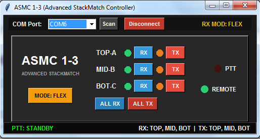

# ASMC 1-3 (Advanced StackMatch Controller)

The **ASMC 1-3** is an advanced, microcontroller-based antenna controller designed for managing multi-antenna arrays (TOP-A, MID-B, BOT-C), fully aligned with the standard **BCC / QRO.CZ** switching matrix. The system consists of an **Arduino Nano** hardware module with optocoupler-isolated PTT input protection and a custom **Python/Tkinter GUI** application for two-way serial communication and real-time monitoring over USB.

---

## 📋 Table of Contents
- [Arduino Pinout](#-arduino-pinout)
- [Relay & Antenna Logic Matrix](#-relay--antenna-logic-matrix)
- [Power-Off Fail-Safe Behavior (NC State)](#-power-off-fail-safe-behavior-nc-state)
- [Python GUI Application Setup & Usage](#-python-gui-application-setup--usage)

---

## 📌 Arduino Pinout

| Arduino Pin | Parameter / Function | Description |
| :--- | :--- | :--- |
| **Pin 2** | `RELAY_1` | Control output for Relay Group 1 (Inverted logic) |
| **Pin 3** | `RELAY_2` | Control output for Relay Group 2 (Inverted logic) |
| **Pin 4** | `RELAY_3` | Control output for Relay Group 3 (Inverted logic) |
| **Pin A5** | `RELAY_4` | Control output for Auxiliary Relay 4 / Phase Switch (Inverted logic) |
| **Pin 5** | `BTN_RX_A` | Pushbutton input for RX Antenna A (TOP) selection |
| **Pin 6** | `BTN_RX_B` | Pushbutton input for RX Antenna B (MID) selection |
| **Pin 7** | `BTN_RX_C` | Pushbutton input for RX Antenna C (BOT) selection |
| **Pin 8** | `BTN_TX_A` | Pushbutton input for TX Antenna A (TOP) selection |
| **Pin 9** | `BTN_TX_B` | Pushbutton input for TX Antenna B (MID) selection |
| **Pin 10** | `BTN_TX_C` | Pushbutton input for TX Antenna C (BOT) selection |
| **Pin 11** | `PTT_PIN` | Optocoupler-isolated PTT input (PC817) |
| **Pin 12** | `BTN_RX_ALL` | Quick button for selecting ALL RX antennas |
| **Pin 13** | `BTN_TX_ALL` | Quick button for selecting ALL TX antennas |
| **Pin A0 - A2**| `LED_RX_A/B/C`| LED status indicators for RX antennas |
| **Pin A3, A6, A7**| `LED_TX_A/B/C`| LED status indicators for TX antennas (supports fade effect) |
| **Pin A4** | `BTN_RX_MODE` | Pushbutton input to toggle between EXCL and FLEX RX modes |

---

## 📊 Relay & Antenna Logic Matrix

All states below represent the actual physical voltage levels present at the Arduino pins, accounting for the software inversion (`!r`) applied to drive the switching transistors:

| Antenna Combination | RELAY_1 (Pin 2) | RELAY_2 (Pin 3) | RELAY_3 (Pin 4) | RELAY_4 (Pin A5) |
| :--- | :--- | :--- | :--- | :--- |
| **TOP (A)** | HIGH (Deactivated) | LOW (Activated) | LOW (Activated) | LOW (Activated) |
| **MID (B)** | LOW (Activated) | HIGH (Deactivated) | LOW (Activated) | LOW (Activated) |
| **BOT (C)** | LOW (Activated) | LOW (Activated) | HIGH (Deactivated) | LOW (Activated) |
| **TOP + MID (A+B)** | HIGH (Deactivated) | HIGH (Deactivated) | LOW (Activated) | HIGH (Activated) |
| **TOP + BOT (A+C)** | HIGH (Deactivated) | LOW (Activated) | HIGH (Deactivated) | HIGH (Activated) |
| **MID + BOT (B+C)** | LOW (Activated) | HIGH (Deactivated) | HIGH (Deactivated) | HIGH (Activated) |
| **ALL (A+B+C)** | HIGH (Deactivated) | HIGH (Deactivated) | HIGH (Deactivated) | HIGH (Activated) |
| **STANDBY (None)** | LOW (Activated) | LOW (Activated) | LOW (Activated) | LOW (Activated) |

---

## 🔌 Power-Off Fail-Safe Behavior (NC State)

The hardware controller is engineered using **NC (Normally Closed)** relay contacts to provide a hardware fail-safe mechanism:

1. When the controller is **unpowered** (or experiences a complete power failure), the switching transistor bases remain unbiased, leaving all relay coils de-energized.
2. In this default unpowered state, the relay contacts fall back to their default **Normally Closed (NC)** positions, connecting **all three antennas (A+B+C)** in parallel.
3. This architecture guarantees an operational fail-safe in contest or station environments: if power is lost, the antenna system defaults to a safe, multi-antenna connection rather than open-circuiting your transceiver.

---

## 💻 Python GUI Application Setup & Usage

The Python GUI provides real-time status monitoring, COM port scanning, manual RX/TX switching, and mode configuration over a serial connection.

### Prerequisites
Ensure Python 3 is installed along with the required serial library:
```bash
pip install pyserial
```
Running the Application

    Connect the Arduino Nano to your PC via USB cable.

    Launch the application:
    Bash

python stack_match_gui.py

Select your Arduino's COM Port from the top drop-down menu and click Connect.

Features:

    Independent antenna toggling (TOP-A, MID-B, BOT-C) for RX and TX paths.

    Dynamic MODE button (EXCL for single antenna selection / FLEX for multi-antenna selection).

    Real-time PTT status visual indicators with smooth LED fading animations during transmission.

---

# ASMC 1-3 (Advanced StackMatch Controller)

ASMC 1-3 je napredni mikrokontrolerski sustav za upravljanje i preklapanje triju visokofrekventnih (HF) antena u StackMatch konfiguraciji (TOP-A, MID-B, BOT-C). Sustav se sastoji od **Arduino Nano** mikrokontrolera koji izvršava logiku preklapanja u realnom vremenu te **Python (Tkinter) GUI** aplikacije za daljinsko upravljanje i nadzor putem serijske (USB) veze.

---

## 🚀 Glavne Značajke

- **Standardna BCC Matrix Logika:** Podrška za rad s pojedinačnim antenama (A, B, C), kombinacijama po dvije (A+B, A+C, B+C) ili svim tri antene istovremeno (A+B+C).
- **Invertirani NC Relejni Izlazi:** Zbog zaštite i specifičnog ožičenja, releji u unpowered (NC) stanju po defaultu spajaju sve antene zajedno.
- **Dual PTT Optokaplerski Ulaz (PC817):** Podrška za HIGH i LOW PTT okidanje s ugrađenim PTT Interlockom i tail-delay zaštitom.
- **Fleksibilni RX/TX Načini Rada:** Podrška za ekskluzivni (EXCL) i fleksibilni (FLEX) RX način preklapanja.
- **Dvosmjerna Serial Komunikacija:** Automatsko usklađivanje stanja između fizičkih tipki na uređaju i Python GUI sučelja.
- **Watchdog Timer (WDT):** Automatsko resetiranje kontrolera u slučaju zastoja.

---

## 📌 Popis Arduino Nano Pinova

| Pin na Arduinu | Tip Pina | Funkcija / Opis |
| :--- | :--- | :--- |
| **D2** | Izlaz | `RELAY_1` (Upravljanje relejem 1) |
| **D3** | Izlaz | `RELAY_2` (Upravljanje relejem 2) |
| **D4** | Izlaz | `RELAY_3` (Upravljanje relejem 3) |
| **A5** | Izlaz | `RELAY_4` (Upravljanje relejem transformatora / fazora) |
| **D5** | Ulaz (Pull-up) | `BTN_RX_A` (RX Antena TOP-A tipkalo) |
| **D6** | Ulaz (Pull-up) | `BTN_RX_B` (RX Antena MID-B tipkalo) |
| **D7** | Ulaz (Pull-up) | `BTN_RX_C` (RX Antena BOT-C tipkalo) |
| **D12** | Ulaz (Pull-up) | `BTN_RX_ALL` (Aktivacija svih RX antena) |
| **A4** | Ulaz (Pull-up) | `BTN_RX_MODE` (Prebacivanje EXCL / FLEX moda) |
| **D8** | Ulaz (Pull-up) | `BTN_TX_A` (TX Antena TOP-A tipkalo) |
| **D9** | Ulaz (Pull-up) | `BTN_TX_B` (TX Antena MID-B tipkalo) |
| **D10** | Ulaz (Pull-up) | `BTN_TX_C` (TX Antena BOT-C tipkalo) |
| **D13** | Ulaz (Pull-up) | `BTN_TX_ALL` (Aktivacija svih TX antena) |
| **D11** | Ulaz (Pull-up) | `PTT_PIN` (Ulaz s PC817 optokaplera) |
| **A0** | Izlaz (PWM/Digital) | `LED_RX_A` (Indikator RX Antena A) |
| **A1** | Izlaz (PWM/Digital) | `LED_RX_B` (Indikator RX Antena B) |
| **A2** | Izlaz (PWM/Digital) | `LED_RX_C` (Indikator RX Antena C) |
| **A3** | Izlaz (PWM/Analog) | `LED_TX_A` (Indikator TX Antena A + Fade efekt) |
| **A6** | Izlaz (PWM/Analog) | `LED_TX_B` (Indikator TX Antena B + Fade efekt) |
| **A7** | Izlaz (PWM/Analog) | `LED_TX_C` (Indikator TX Antena C + Fade efekt) |

---

## ⚡ Tablica Stanja Releja (BCC Matrica & NC Logika)

*(Napomena: Zbog upotrebe `!r` inverzije u kodu i Normally Closed releja, `HIGH` signal s Arduina označava ugašeni relej, dok `LOW` signal označava aktivirani/uključeni relej).*

| Kombinacija Antena | RELAY_1 (D2) | RELAY_2 (D3) | RELAY_3 (D4) | RELAY_4 (A5) |
| :--- | :--- | :--- | :--- | :--- |
| **TOP (A)** | HIGH (Ugašen) | LOW (Uključen) | LOW (Uključen) | LOW (Uključen) |
| **MID (B)** | LOW (Uključen) | HIGH (Ugašen) | LOW (Uključen) | LOW (Uključen) |
| **BOT (C)** | LOW (Uključen) | LOW (Uključen) | HIGH (Ugašen) | LOW (Uključen) |
| **TOP + MID (A+B)** | HIGH (Ugašen) | HIGH (Ugašen) | LOW (Uključen) | HIGH (Ugašen) |
| **TOP + BOT (A+C)** | HIGH (Ugašen) | LOW (Uključen) | HIGH (Ugašen) | HIGH (Ugašen) |
| **MID + BOT (B+C)** | LOW (Uključen) | HIGH (Ugašen) | HIGH (Ugašen) | HIGH (Ugašen) |
| **ALL (A+B+C)** | HIGH (Ugašen) | HIGH (Ugašen) | HIGH (Ugašen) | HIGH (Ugašen) |
| **STANDBY (Nijedna)**| LOW (Uključen) | LOW (Uključen) | LOW (Uključen) | LOW (Uključen) |

---

## 🐍 Upute za Python GUI Aplikaciju

Python sučelje omogućava vizualni nadzor i upravljanje preklapanjem direktno s vašeg računala.

### 1. Preduvjeti

Potrebno je imati instaliran Python 3.x i biblioteku `pyserial`:

```bash
pip install pyserial
```

### 2. Pokretanje Aplikacije

Pokrenite skriptu iz naredbenog retka ili terminala:

```bash
python asm_controller.py
```

### 3. Korištenje Aplikacije

1. **Odabir COM Porta:** U gornjoj traci kliknite na gumb **Scan**, odaberite odgovarajući COM port na koji je spojen Arduino Nano te kliknite **Connect**.
2. **Upravljanje RX Antenama:**
   - Kliknite na gumb **RX** pokraj željene antene (TOP-A, MID-B, BOT-C).
   - Za brzi odabir svih antena odjednom koristite gumb **ALL RX**.
3. **Upravljanje TX Antenama:**
   - Prebacite željene antene za predaju pomoću **TX** gumba ili gumba **ALL TX**.
4. **Izmjena RX Moda:**
   - Klikom na gumb **MODE: EXCL / MODE: FLEX** prebacujete između ekskluzivnog načina (samo jedna antena aktivna na prijemu) i fleksibilnog načina (proizvoljna kombinacija antena na prijemu).
5. **Indikator Stanja:**
   - Donja traka i led indikatori na sučelju u realnom vremenu prikazuju PTT status (STANDBY ili ENGAGED) i trenutno aktivnu kombinaciju antena.
